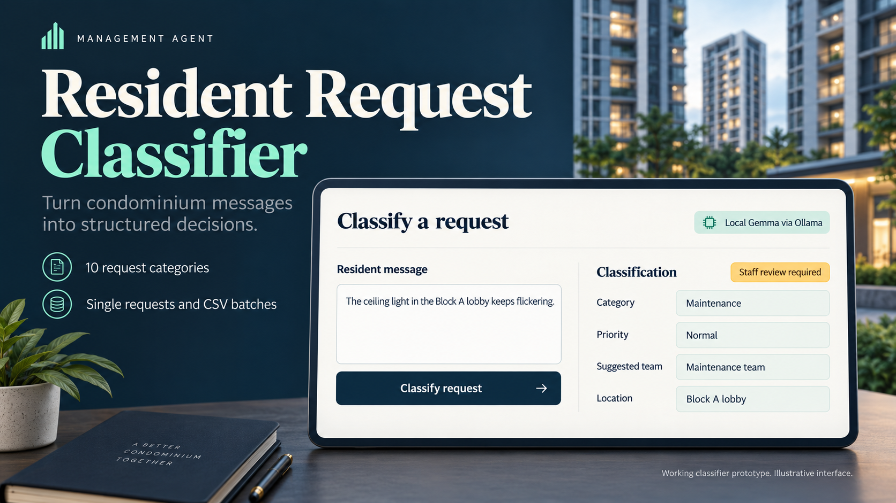

# Management Agent: Resident Request Classifier

A working prototype for organising condominium residents' requests. Each message
is classified into a **category, priority, suggested team and review decision**
to help staff assess what needs attention.

Start with the included offline classifier, or use Ollama to explore local
language-model inference. The project focuses on classification and staff review
as the foundation for a future property-management platform.

## Explore the project

**[Open the online showcase](https://skithrills.github.io/condo-request-classifier/)**
to watch the narrated walkthrough, browse the eight presentation slides and view
the project overview and architecture images. Everything is available in your
browser on a computer or phone.



| View or download | File |
| --- | --- |
| Video, approximately 79 seconds | [MP4](output/demo/Management_Agent_Classifier_Demo.mp4) |
| Telegram bot deck (latest) | [PDF](output/slides/Condo_AI_Agent_Telegram_Bot.pdf) · [Editable PowerPoint](output/slides/Condo_AI_Agent_Telegram_Bot.pptx) |
| Classifier showcase (earlier) | [PDF](output/slides/Management_Agent_Classifier_Showcase.pdf) · [Editable PowerPoint](output/slides/Management_Agent_Classifier_Showcase.pptx) |
| Hero images | [Project showcase](output/hero/01-classifier-showcase.png) · [Classifier architecture](output/hero/02-classifier-architecture.png) |
| Everything for presenting | [Release downloads](https://github.com/Skithrills/condo-request-classifier/releases/latest) |
| Complete source and media | [Download ZIP](https://github.com/Skithrills/condo-request-classifier/archive/refs/heads/main.zip) |

The online showcase is a static presentation. To submit new requests to the
working classifier, run the Streamlit app below. GitHub Pages does not run Python
or Ollama. The original video demonstrates the offline baseline; the slides also
include the later local Gemma evaluation. All demonstration requests are synthetic.

## Quick start on a fresh machine

Install [uv](https://docs.astral.sh/uv/getting-started/installation/), then clone
the repository (requires Git):

```sh
git clone https://github.com/Skithrills/condo-request-classifier.git
cd condo-request-classifier
uv sync --locked --python 3.12
uv run streamlit run app.py
```

Alternatively, use **Code → Download ZIP**, extract it, open a terminal inside
the extracted folder, and run the last two commands. `uv` can install Python 3.12
when needed. The initial dependency download requires internet access.

Open **http://localhost:8501**. The **Offline baseline** works immediately with
the bundled synthetic training data: no API key, Ollama or model download is
required. After dependencies are installed, it can classify offline. Stop the
website with **Ctrl+C** in its terminal. Windows, macOS and Linux can use these
commands; the convenience launchers below are Windows-specific.

## Windows launchers

The prototype website is already implemented in `app.py`. Its form calls
`condo_classifier.service.Classifier` with the project's offline or Ollama backend;
the results are live classifications, not prewritten demo responses.

After completing the dependency setup, run the offline app from the project folder:

```powershell
.\start_project.cmd -SkipOllama
```

This starts or reuses this project's Streamlit website. Keep the launcher window
open. Once Ollama and its model are installed as described below, double-click
**`start_project.cmd`** to start both Ollama and the website. The launcher does not
configure Windows startup or download models. Stopping the website leaves Ollama
running in the background.

The **Offline baseline** is selected by default and needs no API key. To use local
Gemma, choose **Ollama** in the sidebar; the example configuration uses `gemma3:4b`.
Allow extra time for its first request while the model loads. To start only the
website, without starting Ollama:

```powershell
.\start_project.cmd -SkipOllama
```

`-NoBrowser` suppresses automatic browser opening. `run_app.cmd` is also available
as a simple website-only launcher. Neither launcher publishes the site online.

The interface provides single-request classification, a CSV batch workflow,
downloadable JSON/CSV results, a category guide, an evaluation dashboard, and a
**Showcase & setup** tab with slides, video and startup instructions.

The [79-second narrated demo](output/demo/Management_Agent_Classifier_Demo.mp4)
shows the working app with captions. It is an edited walkthrough of captured app
screens; see [demo files and rebuild instructions](output/demo/README.md).

The slide version is available as an editable
[PowerPoint](output/slides/Management_Agent_Classifier_Showcase.pptx) and a
[PDF](output/slides/Management_Agent_Classifier_Showcase.pdf). Preview the slides
inside **Showcase & setup**. The deck includes the later local Ollama results;
the original video shows the earlier offline demo.

## What it classifies

| Category | Examples | Suggested team |
| --- | --- | --- |
| Maintenance | Leaks, lights, lift faults, broken equipment | Maintenance team |
| Security & access | Lost passes, suspicious entry, CCTV requests | Security desk |
| Noise & nuisance | Loud music, barking, renovation noise complaints | Resident relations |
| Cleaning & pests | Rubbish, dirty common areas, pests | Estate services |
| Facilities & bookings | Court, function-room and BBQ reservations | Facilities desk |
| Parking | Visitor permits, occupied lots, obstructing vehicles | Parking desk |
| Billing & payments | Fees, receipts, deposits, refunds | Finance team |
| Renovation & moving | Work applications, contractors, movers | Estate management |
| General enquiries | Office hours, notices, house rules | Management office |
| Other / unclear | Insufficient context or unrelated requests | Management office |

One primary category is returned. Independent requests in one message are flagged
for review when detected. A broken pool pump is maintenance, a pool reservation is
facilities, and a pool-booking refund is billing. Labels and teams are starter
assumptions for staff to confirm; edit `condo_classifier/taxonomy.py` and the data
together when changing them.

## How this relates to Jev

Jev accepts state and typed questions and returns structured decisions.
This project applies that useful pattern to one bounded domain:

| Decision | This project's output |
| --- | --- |
| Choice | One category from a fixed enumeration |
| Urgency | An ordered priority: low, normal, high, emergency |
| Uncertainty | Baseline class scores or an explicitly labelled LLM self-estimate |
| Human handoff | A deterministic review flag and reasons |

This is a project-specific implementation, not Jev's model or a benchmark-equivalent
replica. Its scores are **not calibrated**. The review flag is policy logic, not a
Jev Noul probability. The LLM adapter does not fabricate a probability distribution.
Real labelled examples and a separate calibration split are needed before scores
can justify automatic routing. See `docs/MODEL_CARD.md`.

## Architecture

```text
Streamlit or Python/CLI
        ↓
Pydantic input validation
        ↓
LangGraph: safety_screen → classify → review_policy
              └───────────────────────────↑
        ↓
Validated JSON classification / staff review
```

- **Offline baseline:** word and character TF-IDF features plus logistic regression,
  trained on the bundled 140 synthetic English messages. The model is fitted locally;
  evaluation examples are never passed to `fit`.
- **Ollama:** LangChain `ChatOllama` plus schema validation, grounded evidence spans,
  and one retry for invalid output. Local mode sends a JSON schema. Cloud mode asks
  for JSON and validates the response because Cloud currently lacks schema enforcement.
- **Review policy:** missing locations, low scores, multiple requests, sensitive
  actions and urgent reports are flagged. Every LLM classification requires review
  until its confidence has been independently evaluated.
- **Safety screen:** a small English rule set, with a backstop list of Chinese,
  Malay and Tamil phrases, escalates selected explicit danger phrases before
  calling the model. It is incomplete and cannot serve as an emergency
  detection or dispatch service.

LangGraph supplies a small deterministic workflow here, not a multi-agent platform.
Chroma, RAG, browser/search tools, real work tickets, resident messaging and
fine-tuning are intentionally later phases. This phase never executes a ticket,
payment, access change or approval.

## Try Ollama locally

Install [Ollama](https://ollama.com/download), start it, then download the model:

```sh
ollama pull gemma3:4b
```

If Ollama is not already running, run `ollama serve` in another terminal. On
Windows you can instead start or reuse its server with:

```powershell
.\scripts\start_ollama.ps1
```

The launcher reuses a running server or starts the installed CLI in the background
at `http://127.0.0.1:11434`. It uses one request slot and a 4,096-token context to
limit GPU memory use. It does not add a startup task or change your user PATH.
Run it again after restarting Windows. Optionally copy `.env.example` to `.env`
to customize the configuration. On Windows, preserve an existing configuration:

```powershell
if (-not (Test-Path .env)) { Copy-Item .env.example .env }
```

On macOS/Linux, use `cp -n .env.example .env`. Keep
`OLLAMA_HOST=http://localhost:11434` in `.env` and set `OLLAMA_MODEL` to the model you pulled.
Set `OLLAMA_TIMEOUT_SECONDS=120` if cold model loading exceeds the default timeout.
Select **Ollama** in the sidebar. A local model needs sufficient RAM/VRAM; this
app does not download or install model weights automatically. The launcher accepts
`-OllamaExecutable` for a different binary location and also checks your PATH.

## Try Ollama Cloud

Create an Ollama API key and edit `.env` locally:

```dotenv
OLLAMA_HOST=https://ollama.com
OLLAMA_MODEL=gpt-oss:20b
OLLAMA_API_KEY=your_key_here
OLLAMA_TIMEOUT_SECONDS=45
```

Confirm the model is currently available using Ollama's model list at
<https://ollama.com/api/tags>. Direct Cloud model names differ from some local
daemon `:cloud` or `-cloud` aliases. The API key is read server-side and ignored by
Git. Cloud mode sends the message to Ollama. Use synthetic examples until your
estate has agreed its data-handling requirements. Ollama Cloud has not been tested
with live credentials; local Ollama verification is recorded separately below.

## Is Groq an alternative?

Yes. A suitable initial candidate is `openai/gpt-oss-20b` with
`response_format.type="json_schema"` and `strict=true`. Groq documents strict schema
support for this model. The existing `ModelDecision` contract and review policy can
be reused with a Groq-specific backend. Correct JSON still needs semantic validation
and evaluation against labelled requests.

Groq runs remotely and needs a `GROQ_API_KEY` and internet access; local Ollama runs
on your own hardware. The classifier has **no Groq adapter** (the Telegram bot can
use Groq for translation and voice messages; see below), and no live Groq
classification accuracy or latency measurements have been made. Do not put a Groq URL into the
Ollama server field: the two APIs use different request formats.

As checked on 2026-10-03, Groq lists GPT-OSS 20B at **US$0.075 per million input
tokens and US$0.30 per million output tokens**. For illustration, 1,000 input plus
200 total billed output tokens costs about US$0.000135 per request, or US$1.35 per
10,000 requests. This excludes retries and any extra reasoning tokens; actual usage
must be measured. Its listed free limits are 30 requests/minute, 1,000/day and
8,000 tokens/minute; your account's limits are authoritative.

For this project, start with local Gemma for offline development, then benchmark
Groq GPT-OSS 20B on the same frozen dataset if hosted deployment is needed. Retain
the staff-review policy for both. Check Groq's data controls before using real
resident messages; hosting open-weight models does not make the hosted service
self-hosted or offline.

Sources: [structured outputs](https://console.groq.com/docs/structured-outputs),
[models and prices](https://console.groq.com/docs/models),
[rate limits](https://console.groq.com/docs/rate-limits),
[data controls](https://console.groq.com/docs/your-data).

## Try Claude (Anthropic API)

The `claude` backend calls Claude Haiku 5.5 by default through the Anthropic API.
Responses are constrained to the same `ModelDecision` schema with structured
outputs, then checked for verbatim evidence and location spans. Like Ollama, its
confidence is a self-estimate, so every Claude classification goes to staff review.

Set `ANTHROPIC_API_KEY` in `.env` (see `.env.example`), then:

```sh
uv run python -m condo_classifier --backend claude classify "The lobby light is broken"
```

For the Telegram bot, set `CLASSIFIER_BACKEND=claude`. `CLAUDE_MODEL` and
`CLAUDE_EFFORT` (default `low`) can be changed in `.env`. Each request is billed
to your Anthropic account; a short classification costs a fraction of a cent.

## Telegram bot (resident side, early)

Residents can chat with the bot on Telegram. Every message goes through the
classifier first, using everything the resident has said so far, so details sent
later (like a unit number) fill in what was missing. Claude Haiku 5.5 then writes a
short reply from the classifier's notes. It only asks a question when the
classifier says a detail is missing, so it stops asking once the request is complete.
Emergencies always get the fixed safety text, never generated wording. The bot
cannot approve, book or pay for anything. Greetings and a closing "thanks" get a
quick canned reply and never open a request.

**Photos.** Residents can send a photo (with or without a caption) or an image file.
Claude Haiku 5.5 describes it in a sentence or two, and the description joins the
conversation as `[Photo: ...]`, so the classifier, safety screen, chat, staff card and
dashboard all use it like text. Photos over `IMAGE_MAX_EDGE` pixels are shrunk first,
which loses nothing the model would see. Saved copies go next to the request database
(`data/private/photos/`), are posted under the staff card, and appear on the dashboard.
Photos are saved only once a request is understood. For off-topic photos the offline
baseline classifier can guess a category; `CLASSIFIER_BACKEND=claude` reads them better.

**Buttons.** While the bot is still asking for details there are no buttons. Once a
request has everything it needs, the bot shows a 📋 work-order summary with
**✅ Submit**, **✖️ Cancel** and **🙋 Talk to a person**. Residents can also send
`/human` at any time to get a staff member, which pings staff with a fresh card.
Submitting or cancelling closes the request; the next message starts a new one.

**Reactions.** The bot reacts only when a request changes state: 👌 ready to submit ·
🫡 submitted · 🙏 wants a person · 😱 emergency · 🤔 couldn't understand or something
failed.

Each request also appears in a staff Telegram group or channel as one card with
the status, category, team, priority, location, missing details, review notes and the
resident's messages. The card is edited in place as the resident adds details or taps
a button, so the group is not flooded. An emergency or a request for a person posts a
fresh message so it notifies everyone. Greetings and unclear chatter only reach staff
once the request is understood. The bot only answers residents in private chats and
ignores other messages in the staff group. Conversations live in memory and reset
after 2 idle hours, on `/new`, or when the bot restarts.

**Common questions (FAQ).** Questions like "what time does the gym close?" are answered
from the building FAQ in `data/condo_faq.csv` (30 synthetic entries for a fictional
condo; replace them with your building's). This is retrieval-augmented generation: the
bot finds the closest entries (TF-IDF over each entry's question and keywords, local
and free) and gives them to the chat model, which answers only from them. A message is
answered only if it reads like a question *and* an entry scores at least 0.20, because
a report such as "I was charged twice for my maintenance fee" scores high against the
fees entry too. On the 46 test messages in `data/faq_eval.csv` that answers 33 of 36
questions correctly, 1 with the wrong entry, and none of the 10 reports. A standalone
question is logged as 📖 Answered by FAQ on the dashboard with no staff card; a question
in the middle of a request just gives the chat model the facts. Emergencies never use
the FAQ. With `BOT_REPLIES=fixed` the bot sends the entry's answer as written. Turn it
off with `FAQ=off`, or point `FAQ_PATH` at your own CSV (`id,question,answer,keywords`).

**Run it locally**

1. Install [uv](https://docs.astral.sh/uv/getting-started/installation/).
2. Create a bot with [@BotFather](https://t.me/BotFather) and copy its token.
   Create an API key at [platform.claude.com](https://platform.claude.com).
3. Double-click **`run_bot.cmd`** on Windows, or run `./run_bot.sh` on macOS/Linux.
   The first run creates `.env`; paste `TELEGRAM_BOT_TOKEN` and `ANTHROPIC_API_KEY`
   into it, save, and run the launcher again.
4. Message your bot on Telegram. Stop it with **Ctrl+C**.

**Connect the staff group**

1. Create a Telegram group for staff (or a channel) and add your bot. In a
   channel, make the bot an admin that can post messages.
2. With the bot running, send `/chatid` in that group or channel.
3. Paste the number into `.env` as `STAFF_CHAT_ID` (group IDs start with `-`)
   and restart the bot.

Without `STAFF_CHAT_ID` the bot still chats with residents, but logs a warning
that requests are not reaching staff.

**Staff replying through the bot**

In the staff group, **reply** to a request card (or to a resident message the bot
forwarded) and the bot sends it to the resident as "👤 Staff: ..." (staff names aren't shown). From then
on the AI stays quiet for that resident: their messages and photos are forwarded under
the card, though a new emergency still gets the safety text at once. Reply **`/done`**
to the card to finish; the resident is told and the AI takes over again. The dashboard
shows these requests as 👤 With staff and then ✔️ Resolved. A 👍 on your message means
it reached the resident. Normal chat in the staff group is ignored.

**Test groups with other bots**

Set `GROUP_REPLIES=on` to let the bot join a shared test group. It answers only messages
that @mention it, reply to one of its messages, or use `/ask@yourbot <message>`; normal
messages get no reply. Each person in the group has their own request, and only they can
tap its buttons. The staff group (`STAFF_CHAT_ID`) never gets resident replies.

Another bot can talk to yours if one of the two has **Bot-to-Bot Communication Mode**
turned on in @BotFather. Telegram then delivers that bot's message only when it replies
to your bot or uses `/ask@yourbot ...`; a plain `@yourbot` typed by a bot isn't delivered.
To stop two bots answering each other forever, the bot replies to other bots at most
`BOT_TO_BOT_LIMIT` times (default 3) per group within 10 minutes, and the count resets
when a person addresses it.

**Staff dashboard**

Requests are saved to `data/private/requests.db` (gitignored; change it with
`REQUESTS_DB`). With the bot running, double-click **`run_dashboard.cmd`** (or run
`./run_dashboard.sh`) and open http://localhost:8502. An overview panel shows what
needs attention, new work orders, requests with staff or still with the bot, and the
queue's status mix. Below it, each request is a card with the resident's Telegram
profile photo (when their privacy settings allow; initials otherwise), status,
category, location, team and latest message, with the full conversation, notes and
photos one click away. Filters sit in the sidebar and the page refreshes every 15
seconds (pause it with Live refresh while deleting). Tick rows in
the table and press 🗑️ **Delete selected** (or use Delete inside a request's details);
after a confirmation it removes the requests and their photos; the bot won't save a deleted request again if that resident keeps chatting.
To move a request along, open its details and pick **Open**, **In progress** or
**Done**, or tick rows in the table and use **Set status**. A resident's follow-up
message won't undo it, but an emergency or a request for a person still takes over.
Run it on the same machine as the bot.

**Run the bot on local models (Ollama, no API key)**

A local Ollama server needs no key (`OLLAMA_API_KEY` is only for Ollama Cloud). Each
part of the bot picks its model separately in `.env`:

```ini
CLASSIFIER_BACKEND=ollama      # sorts requests
OLLAMA_MODEL=phi4-mini         # or the winner of the benchmark below
CLASSIFIER_FALLBACK=baseline   # if Ollama isn't running, use the offline model
BOT_REPLIES=ollama             # chat replies (claude, ollama or fixed)
PHOTOS=ollama                  # photo descriptions (claude, ollama or off)
OLLAMA_VISION_MODEL=gemma3:4b  # must be a vision model
```

Text-only models such as `phi4-mini` can't see photos, so photos stay off until
`OLLAMA_VISION_MODEL` names a model with vision. `OLLAMA_CHAT_MODEL` can give chat a
different model from the classifier.

**Fallbacks.** Keep Claude as the main model and let local models take over when it
fails (no credits, a bad key, an outage):

```ini
CLASSIFIER_BACKEND=claude
CLASSIFIER_FALLBACK=ollama,baseline   # tried in order
BOT_REPLIES=claude
CHAT_FALLBACK=ollama                  # if both fail, the bot sends fixed replies
```

Each request records which backend classified it, so the dashboard shows when a
fallback was used.

**Pick a local model**

```sh
uv run python scripts/benchmark_models.py                      # every installed model
uv run python scripts/benchmark_models.py phi4-mini gemma4:12b # or just these
```

Use the names `ollama list` prints. The script runs the 55-message evaluation set
through each model next to the offline baseline and prints category accuracy, macro F1,
priority accuracy, invalid outputs, how often the "Model score is below the review
threshold" note appears, latency, and four sample chat replies per model. It saves
`reports/model-benchmark.md` and tells you which `OLLAMA_MODEL` to set. The offline
baseline's scores are spread thin, so about 70% of requests get that note; a model's
self-reported confidence is usually higher. Staff cards no longer show the "LLM
confidence is not calibrated" note, which every LLM result carries.

**Try conversations without Telegram**

```sh
uv run --extra telegram python scripts/try_conversations.py
```

This runs a few scripted resident chats (including an FAQ question) through the real
bot logic with the classifier and chat model from `.env`, prints each reply with its
status and word count, and estimates the cost when Claude is used.

**Chinese, Malay, Tamil and voice messages**

The safety rules and offline classifier are written for English, so with
`TRANSLATE_WITH` set the bot translates each message to English first. The
classifier reads the English; staff cards show the resident's own words with an
`EN:` line under each; Claude replies in the resident's language. Translated
requests always go to staff review. The safety screen checks both the translation
and the original, with a backstop list of Chinese, Malay and Tamil emergency
phrases, and the emergency reply is fixed text in the resident's language plus
English. The Malay and Tamil wording needs review by a native speaker.

With `TRANSCRIBE_WITH` set, residents can also send voice messages up to 2 minutes.
Whisper transcribes them in the language spoken, the bot shows the resident what
it heard (so a misheard unit number can be corrected), and the original voice
message is posted under the staff card. Audio is never saved or logged. Whisper's
language guess can be wrong on short clips (accented English often comes out as
Malay or Indonesian), so residents can send `/language` to pick English, 中文,
Bahasa Melayu or தமிழ் for their voice messages; the choice lasts until the bot
restarts.

1. Create a free key at [console.groq.com/keys](https://console.groq.com/keys).
2. In `.env`, set `GROQ_API_KEY`, `TRANSLATE_WITH=groq` and `TRANSCRIBE_WITH=groq`.
3. Restart the bot.

Providers are tried in order, so `TRANSLATE_WITH=groq,ollama` falls back to your
local Ollama model and `TRANSCRIBE_WITH=groq,local` falls back to faster-whisper
on your own computer (the launchers install it when `.env` says `local`; the
`large-v3-turbo` model downloads about 1.6 GB on first use). `claude` also works
as a translator, billed to your Anthropic account. As reported for October 2026,
Groq's free plan allows Whisper 20 requests/minute, 2,000/day and 28,800 audio
seconds/day (each request counts as at least 10 seconds), and GPT-OSS 1,000
requests/day; check your account's limits page. Both settings are sent to Groq,
so check [Groq's data controls](https://console.groq.com/docs/your-data) before
real resident use.

`.env` is gitignored, so your keys stay on your machine. Useful settings:

| Setting | Default | Meaning |
| --- | --- | --- |
| `STAFF_CHAT_ID` | not set | Staff group or channel that receives request cards |
| `BOT_REPLIES` | `claude` | `claude` (or `chat`) or `ollama` for model replies, `fixed` for templates |
| `CHAT_FALLBACK` | `none` | Chat models to try when the main one fails, e.g. `ollama` |
| `CLASSIFIER_BACKEND` | `baseline` | `baseline`, `ollama` or `claude` |
| `CLASSIFIER_FALLBACK` | `baseline` | Backends to try in order when the main one fails, or `none` |
| `PHOTOS` | `claude` | `claude` (or `on`), `ollama` (needs `OLLAMA_VISION_MODEL`) or `off` |
| `FAQ` / `FAQ_PATH` | `on` / `data/condo_faq.csv` | Answer common questions from the FAQ |
| `CHAT_MODEL` / `CHAT_EFFORT` | `claude-haiku-5-5` / `low` | Model and effort for chat replies |
| `TRANSLATE_WITH` | not set | `groq`, `ollama` and/or `claude`, tried in order |
| `TRANSCRIBE_WITH` | not set | `groq` and/or `local`, tried in order; turns voice messages on |
| `GROQ_TRANSLATE_MODEL` / `GROQ_WHISPER_MODEL` | `openai/gpt-oss-120b` / `whisper-large-v3` | Groq models |
| `LOCAL_WHISPER_MODEL` | `large-v3-turbo` | faster-whisper model; `small` for slower computers |
| `DAILY_MESSAGE_LIMIT` | `20` | Messages per resident per day; `0` turns the limit off |
| `BOT_UNLIMITED_IDS` | not set | Comma-separated Telegram IDs that are never limited |

Past the daily limit the bot stops calling Claude and replies with buttons instead:
**Emergency**, **Repair / work order**, **Question** and **Ask office to contact me**.
The tapped button sets the category, and the resident's held messages go to the staff
chat unclassified. Emergency always works; the other buttons allow 3 requests an hour.
Messages that trip the rule-based emergency screen are still escalated as usual.
Past the limit, photos are not described (only their caption is held) and voice
messages are still transcribed so staff can read them.
In the staff chat, send
`/unlimit <Telegram ID>` to lift a resident's limit, or `/relimit <Telegram ID>`
to restore it; the ID is on each request card. Limits reset when the bot restarts.

Message text and audio are never logged. Claude's system prompt (`SYSTEM`) lives in
`condo_classifier/chat.py`; fixed replies and button texts live in
`condo_classifier/replies.py`; translation and voice live in `condo_classifier/language.py`
and `condo_classifier/voice.py`.

## Command line and Python

```powershell
uv run python -m condo_classifier classify "The lobby light is broken."
uv run python -m condo_classifier --backend ollama classify "Can I book the function room?"
uv run python -m condo_classifier evaluate --output reports/baseline-evaluation.json
```

```python
from condo_classifier.backends import BaselineBackend
from condo_classifier.schema import ResidentRequest
from condo_classifier.service import Classifier

classifier = Classifier(BaselineBackend())
result = classifier.classify(
    ResidentRequest(
        text="The corridor light keeps flickering.",
        location="Block A, level 5",
    )
)
print(result.model_dump_json(indent=2))
```

Provider failures return `status="provider_error"`, no confidence and a review
requirement. They never silently switch to the offline model. Emergency rules can
return `status="safety_escalation"` without using the selected provider. The `backend`
field always identifies which path supplied the result.

CSV input uses a required `text` column and optional `channel` and `location`.
Supported channels are `Web`, `WhatsApp`, `Email`, and `Phone transcript`. Use
`data/batch_example.csv` as a template. Up to 100 rows / 2 MB are accepted, invalid
rows are reported individually, and formula-like CSV cells are escaped on export.

## Verification

```powershell
uv run pytest -q
uv run ruff check .
uv run python -m condo_classifier evaluate
```

The starter evaluation contains 55 synthetic messages: 50 ordinary requests and
five explicit emergencies. Initial results: **53/55 categories correct (96.4%)**,
macro F1 **0.963**, priority accuracy **98.2%**, review rate **87.3%**, and **5/5**
explicit emergency examples flagged. Emergency cases include deterministic rules.
These are development checks on a small authored dataset, not production accuracy
or a reliable estimate of emergency recall.

Tests cover schemas, review rules, negated/hypothetical emergency phrases,
provider failures, retry limits, CSV handling, Streamlit interactions, and a real
LangChain HTTP round trip against a **simulated** Ollama endpoint.

### Live local Ollama verification - 2026-10-03

Ollama **0.35.0** was installed and tested entirely through the terminal/API, using
**`gemma3:4b` (4.3B parameters, Q4_K_M)** on an NVIDIA RTX 3080 with 10 GB VRAM.
All model layers were offloaded to the GPU. The installed model digest is recorded
in [the verification report](reports/ollama-verification.json).

The evaluation contains **55 cases, not 56**: 50 invoke the model, while five
explicit emergency cases use deterministic safety rules. On the final run:

- 48/50 model requests produced valid responses; two failed validation and went to review.
- 42/50 model requests produced a valid, correct category, compared with 48/50 for
  the offline baseline on these same ordinary examples. The baseline remains the default.
- Mean warmed latency was **1.12 seconds for valid responses**, or **1.32 seconds
  across all 50 attempts**, including validation retries. Median valid latency was
  **1.09 seconds**. The separate first cold request took **86.6 seconds**.
- A live Streamlit AppTest confirmed the Ollama result and the emergency-rule path.
  All **63 automated tests** and Ruff checks passed. The initial build had 56 tests;
  that number did not describe live model requests.

The first run exposed quoted evidence framing from the small model. Matching outer
quotation marks are now removed only when the remaining text is an exact input
span. Unsupported evidence still fails validation. The initial run is retained in
`reports/ollama-initial-evaluation.json`; the rerun is in
`reports/ollama-evaluation.json`. The latter's raw category metric counts one rejected
case's `other` fallback as correct, so the model-success comparison above excludes it.
Both runs use a synthetic development set; neither establishes production accuracy.
The existing video demonstrates the offline baseline and predates this live setup.

## Project files

- `app.py`: Streamlit interface.
- `condo_classifier/`: schemas, model adapters, triage workflow, CSV and evaluation.
- `data/`: synthetic training/evaluation data and example upload.
- `reports/baseline-evaluation.json`: reproducible metrics and every prediction.
- `reports/ollama-evaluation.json`: live local model evaluation and rejected responses.
- `reports/ollama-verification.json`: runtime/model identity, latency and live app checks.
- `scripts/start_ollama.ps1`: start or reuse the local background inference server.
- `docs/MODEL_CARD.md`: limitations and next steps for a credible pilot.
- `output/demo/`: presentation video, captions and supporting files.

## References

The supplied [crystalbuilds/llm-project](https://github.com/crystalbuilds/llm-project)
informed the prompt/schema/UI separation. This is a fresh implementation for
condominium requests; upstream application code is not vendored. The local
stakeholder reference informed the triage fields and approval boundary and is not
redistributed. Credentials, private inputs, local environments and model weights
are excluded from this repository.

- [TypeSafe's Jev introduction](https://docs.typesafe.ai/introduction)
- [Ollama structured outputs and the Cloud limitation](https://docs.ollama.com/capabilities/structured-outputs)
- [Ollama Cloud setup](https://docs.ollama.com/cloud)
- [LangChain ChatOllama](https://docs.langchain.com/oss/python/integrations/chat/ollama)
- [LangGraph graph API](https://docs.langchain.com/oss/python/langgraph/graph-api)
- [Streamlit app testing](https://docs.streamlit.io/develop/api-reference/app-testing/st.testing.v1.apptest)
